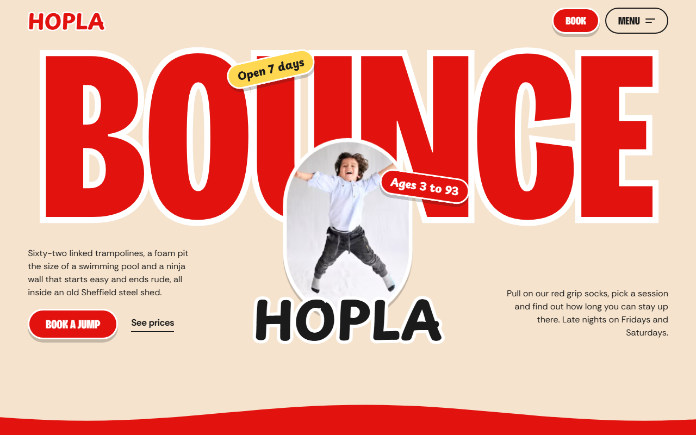
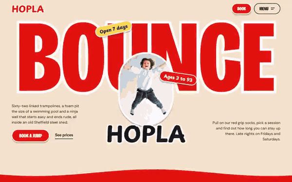

# Free HTML trampoline park website template with GSAP scroll animations — Hopla

**Website for a trampoline park or indoor family activity venue: a free HTML template in one file, with GSAP scroll animations, no build step, MIT license. Made by [8B](https://8b.com/), the AI website builder.**

[](LICENSE)  

**[Live demo](https://8bsite.github.io/trampoline-park-website-template/)** · **[Use this template](https://github.com/new?template_name=trampoline-park-website-template&template_owner=8bsite)** · **[Download ZIP](https://github.com/8bsite/trampoline-park-website-template/archive/refs/heads/main.zip)** · **[Template page on 8b.com](https://8b.com/templates/hopla/)**

<a href="https://8bsite.github.io/trampoline-park-website-template/"></a> <a href="https://8bsite.github.io/trampoline-park-website-template/"></a>

<p align="center"><a href="https://8bsite.github.io/trampoline-park-website-template/"></a><br><sub>Scroll animation</sub></p>

A one-page site for an indoor trampoline park with zones, sessions, birthday parties, a café, a league table, prices and booking. Cream, red and yellow fields with wobbly trampoline-bed edges and big condensed type; the page bounces as you scroll: a jumper is launched off the first screen, photo discs hop down the zone list and a red ball hops along the party route.

Good for: trampoline park or bounce centre; indoor play centre or soft play; climbing, ninja or adventure park; kids' party venue; any family leisure venue with sessions, passes and bookings.

## Use it with an AI coding agent

Download the files into your project (in Windows PowerShell type `curl.exe`):

```bash
curl -LO https://raw.githubusercontent.com/8bsite/trampoline-park-website-template/main/index.html
curl -LO https://raw.githubusercontent.com/8bsite/trampoline-park-website-template/main/AGENTS.md
curl -LO https://raw.githubusercontent.com/8bsite/trampoline-park-website-template/main/LICENSE
curl -LO https://raw.githubusercontent.com/8bsite/trampoline-park-website-template/main/CREDITS.md
```

Then give your agent this prompt:

```text
Read AGENTS.md, then edit index.html. Use this template as the base for a site for <your venue: what it is (trampoline park, play centre, climbing or adventure park), city and address, activities or zones, sessions and opening hours, prices, parties, how to book>. Keep the layout, the motion and the single-file format; replace the brand name, copy, photos, prices, hours, links and contacts, and recolour it through the CSS variables if needed.
```

Give the agent the downloaded file, not a link: from a link it would rebuild a different page. No agent? Click **[Use this template](https://github.com/new?template_name=trampoline-park-website-template&template_owner=8bsite)**, edit `index.html` and turn on **Settings → Pages**.

## What's on the page

- **Navigation** — fixed top bar: wordmark, Book button, Menu button opening a full-screen link overlay with contacts
- **Bounce at Hopla, the trampoline park in Sheffield** — first screen: one giant word with a photo of a jumper in front, wordmark, two stickers, two short texts; then a red panel with heading, button and three tilted photos
- **One roof, six ways off the ground** — list of six activity zones in a zig-zag: big name, one line, age sticker, round photo (demo: trampoline zones)
- **The best bit is the middle** — full-width photo with a two-line statement held on screen while you scroll
- **One shed, five crowds** — timetable of five sessions as tickets: time, name, text, ages, photo (ground turns from morning yellow to night)
- **Birthday parties, sorted** — birthday parties: heading, text, price line, button, and a five-step route with numbered tilted photos
- **The Landing** — on-site café: wide photo, round coffee photo, sticker, text, short price list
- **Ninja Wall League** — ranking table of six results on a dark field, with heading, text, entry link and photo (demo: ninja wall times)
- **House rules, short version** — red wall of five tilted rule stickers and one photo (house rules)
- **Pick a pass** — five ticket-shaped passes with name, price and one line, plus two buttons
- **Asked a lot** — questions and answers (native &lt;details&gt;) next to a heading and a phone line
- **Come and jump** — address, opening hours, phone, email, directions and a booking request form (placeholders)
- **Footer** — links, address and phone, copyright with the Design: 8B credit, a giant outlined HOPLA wordmark with three round photos

## Design

Palette:        
Fonts: Bricolage Grotesque, Playpen Sans, Rethink Sans (Google Fonts). Change both through the CSS variables in the `:root` block at the top of `<head>`. A big display line with `style="--len:N"` fills its width: set N to its new number of characters.

- The wavy section edges are inline SVGs (class m-wave); each coloured section starts with one. Their colour follows the section's background.
- The sessions background colour run and the Glow Night glow use --color-4, --color-5, --color-2 and --color-3: recolour through the tokens and the run follows.
- The rules and the FAQ mention an online waiver, but the page has no waiver link: add one if you use a waiver service, or edit the text.

## Before you publish

- Replace everything marked `data-8b-placeholder` (social preview image, favicon, phone, email, form) and the invented demo facts: prices, dates, address. [AGENTS.md](AGENTS.md) lists them.
- The form sends nothing yet: connect it to Formspree or Netlify Forms, or remove it.

## Tech

GSAP 3.13.0, ScrollTrigger, SplitText, MotionPathPlugin, Lenis 1.3.27 from jsDelivr, 126 KB, no build step. Chrome and Edge 111+, Safari 16.2+, Firefox 113+ (it uses color-mix(), cascade layers, small/dynamic viewport units). With "reduce motion" on, the page is complete and still.

## License

MIT, see [LICENSE](LICENSE); the "Design: 8B" footer link is welcome, not required. Photos, fonts and libraries keep their own licences: [CREDITS.md](CREDITS.md). More free templates: [8b.com/templates](https://8b.com/templates/) · [github.com/8bsite](https://github.com/8bsite).
